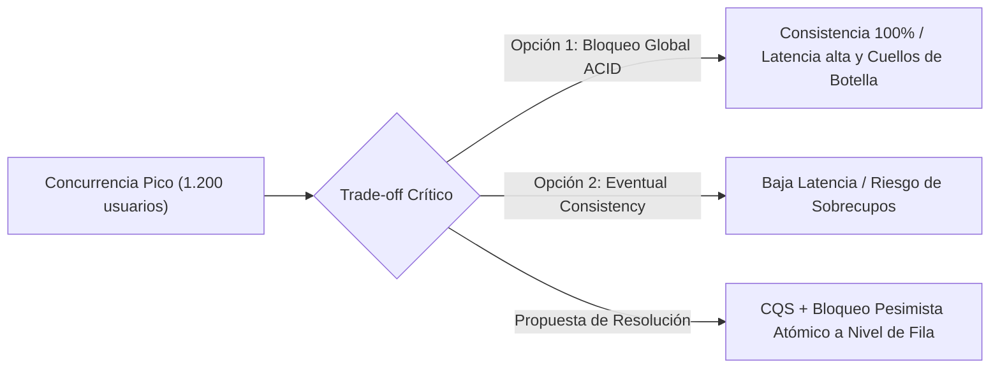
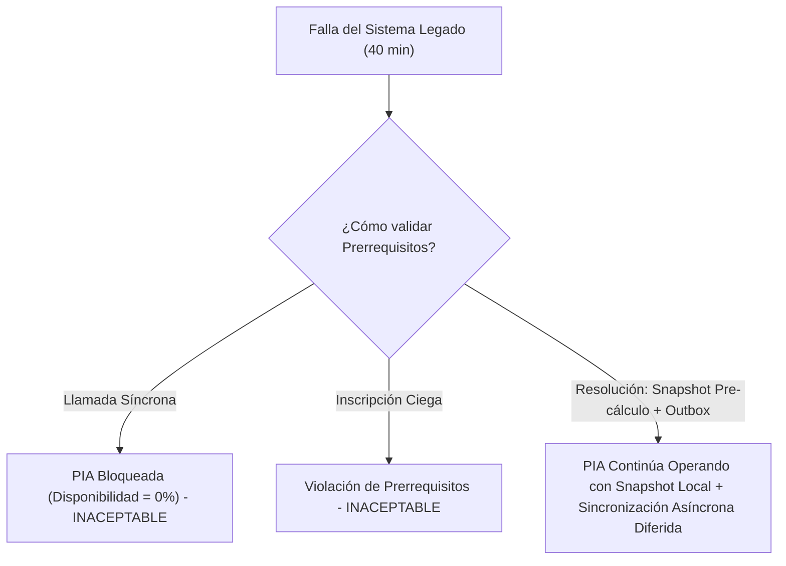

# Actividad 1: Identificación y Priorización de Drivers Arquitectónicos

**Plataforma de Inscripción Académica (PIA) - Universidad de La Salle**  
- **Estudiante:** Andrés Luengas Sánchez  
- **Documento de Identidad:** Cédula de Ciudadanía (Terminación en 8)  
- **Correo Institucional:** aluengas98@unisalle.edu.co  
- **Situación Extraordinaria Asignada:** **Escenario A: Indisponibilidad** (Último dígito PAR: Caída del sistema académico legado durante 40 minutos al inicio de la matrícula).  

---

## 1. Contexto y Justificación del Análisis

La Universidad de La Salle gestiona una población aproximada de 24.000 estudiantes distribuidos en 5 facultades y atendidos por 1.100 docentes. El sistema actual, con más de 12 años en producción, colapsa en los períodos de mayor demanda debido a la contención en base de datos, duplicidad de inscripciones por reintentos no controlados, sobrecupos e indisponibilidad del backend legado. 

Para que la nueva **Plataforma de Inscripción Académica (PIA)** sea viable técnica y financieramente, sus decisiones estructurales no pueden basarse en suposiciones subjetivas ni en modas tecnológicas, sino en **Architectural Drivers** rigurosamente identificados, caracterizados y priorizados frente a las restricciones institucionales (C01 a C10) y al **Escenario A**.

---

## 2. Objetivos de Negocio (Business Goals)

| ID | Objetivo de Negocio | Descripción | Impacto Estratégico |
| :--- | :--- | :--- | :--- |
| **ON-01** | **Continuidad y Satisfacción del Proceso de Matrícula** | Garantizar que el 100% de los estudiantes habilitados para matricular puedan completar su proceso dentro de las ventanas programadas, eliminando frustraciones, colapsos del portal y quejas masivas en canales de atención. | Imagen institucional, retención estudiantil y cumplimiento del calendario académico oficial. |
| **ON-02** | **Cero Inconsistencias y Equidad en Asignación de Cupos** | Garantizar que la asignación de cupos sea estrictamente atómica, transparente y justa, erradicando por completo los sobrecupos no autorizados y las inscripciones duplicadas producidas por reintentos de usuarios. | Cumplimiento del Estatuto Estudiantil y reglamentos académicos de las 5 facultades. |
| **ON-03** | **Sostenibilidad Operativa y Tecnológica (Bajo TCO)** | Implementar una arquitectura mantenible y desplegable sobre la infraestructura propia de la universidad (Linux y PostgreSQL), operable de manera eficiente por el equipo disponible (4 desarrolladores y 1 administrador). | Optimización del presupuesto institucional al evitar contratación de plataformas comerciales adicionales. |

---

## 3. Restricciones Arquitectónicas (Architectural Constraints)

| ID | Restricción | Origen | Descripción y Límite Técnico Impuesto |
| :--- | :--- | :--- | :--- |
| **RES-01** | **Infraestructura Base Exclusiva** | Condición C08 | La universidad dispone de servidores **Linux** y motor de base de datos **PostgreSQL**. No está autorizada la adquisición inicial de licencias de software comercial, servicios cloud propietarios (AWS, Azure, GCP) ni bases de datos licenciadas (Oracle, SQL Server). Toda la solución debe basarse en software de código abierto (*open source*) desplegable en la infraestructura *on-premises* o privada institucional. |
| **RES-02** | **Capacidad Humana de Soporte y Mantenimiento** | Condición C10 | El equipo institucional permanente está conformado únicamente por **4 desarrolladores y 1 administrador de infraestructura**. La arquitectura no puede introducir una sobrecarga operacional excesiva (como mallas de microservicios distribuidos complejos, clústeres de Kubernetes de alta dificultad o tecnologías esotéricas) que supere las capacidades del equipo. |
| **RES-03** | **Legado como Fuente Oficial de Historial y Prerrequisitos** | Condición Adicional | El sistema académico legado de 12 años continuará siendo la **fuente oficial (*Source of Truth*)** del historial académico consolidado y las mallas curriculares. La PIA es dueña transaccional del proceso de inscripción del período activo y debe sincronizar bidireccionalmente los resultados con el legado sin bloquearse ante sus fallas. |
| **RES-04** | **Protección de Datos y Trazabilidad Legal** | Condición C09 | Obligatoriedad de controles de acceso (RBAC), cifrado de datos en tránsito (TLS 1.3) y en reposo, y registro inmutable de auditoría forense para cada transacción, en estricto cumplimiento de la Ley Estatutaria 1581 de 2012 (Protección de Datos Personales en Colombia). |

---

## 4. Drivers de Atributos de Calidad (Quality Attribute Drivers)

A partir de las condiciones C01-C07 y el Escenario A, se determinan los siguientes drivers prioritarios:

1. **QA-01: Disponibilidad y Tolerancia a Fallos (Availability & Fault Tolerance)**
   - *Condiciones C03, C05, Escenario A.*
   - La plataforma debe operar ininterrumpidamente durante los períodos de matrícula ($\ge 99.9\%$ uptime mensual, lo que permite un tiempo de inactividad no planificado acumulado inferior a 43.8 minutos en el mes).
   - Debe tolerar la **indisponibilidad total del sistema legado durante hasta 40 minutos (Escenario A)** sin interrumpir las inscripciones de asignaturas válidas ni generar errores visibles al estudiante.

2. **QA-02: Rendimiento y Eficiencia de Capacidad (Performance & Scalability)**
   - *Condiciones C01, C02.*
   - Soporte concurrente garantizado para **1.200 estudiantes concurrentes** en las primeras horas pico de matrícula.
   - El **95% de las consultas de catálogo, asignaturas y grupos disponibles debe responder en máximo 2,0 segundos** (percentil $P_{95} \le 2.0\text{ s}$).

3. **QA-03: Consistencia e Integridad Transaccional (Data Consistency & Integrity)**
   - *Condiciones C04, C07.*
   - **Cero sobrecupos ($0$ inscripciones por encima de la capacidad)** bajo cualquier condición de concurrencia o reintentos simultáneos.
   - Tolerancia estricta a la pérdida de datos: **RPO (Recovery Point Objective) $\le 5$ minutos** y RTO $\le 30$ minutos (C06).
   - Idempotencia garantizada ante reintentos de peticiones por parte de usuarios impacientes o problemas de conectividad de red.

4. **QA-04: Modificabilidad y Mantenibilidad (Modifiability & Maintainability)**
   - *Condición C10, Problema identificado de reglas de negocio.*
   - El equipo de 4 desarrolladores debe poder incorporar o ajustar reglas de matrícula (prerrequisitos especiales, créditos máximos por promedio, excepciones de facultad) sin requerir reingeniería completa del sistema, limitando el esfuerzo de cambio a menos de 8 horas-hombre por regla nueva.

5. **QA-05: Auditabilidad y Trazabilidad (Auditability & Security)**
   - *Condición C09, RF5.*
   - Cada intento de inscripción, confirmación, rechazo y cancelación debe generar una traza inmutable (ID estudiante, grupo, IP de origen, timestamp UTC en milisegundos, token de sesión y resultado).

---

## 5. Matriz Completa y Priorización de Drivers

La priorización se realiza utilizando el esquema **MoSCoW** y la ponderación por impacto en el negocio vs. riesgo arquitectónico (Alta / Media / Baja):

| Identificador | Descripción del Driver | Categoría | Origen | Prioridad | Medida de Aceptación Cuantificable | Justificación Arquitectónica |
| :--- | :--- | :--- | :--- | :--- | :--- | :--- |
| **DRV-01** | Consistencia estricta de cupos e idempotencia | Calidad (Consistencia) | C04, Dolor Legado | **Alta (Must Have)** | $0$ sobrecupos registrados. $0$ inscripciones duplicadas ante $\ge 5$ reintentos automáticos del mismo usuario. | La sobreventa de cupos invalida el proceso legal y académico, generando quejas disciplinarias y caos organizativo. |
| **DRV-02** | Resiliencia ante caída del sistema legado | Calidad (Disponibilidad) | C05, Escenario A | **Alta (Must Have)** | 0 interrupciones en el flujo de inscripción durante una caída de 40 min del legado. 100% de sincronización posterior sin inconsistencias. | El sistema legado fallará con certeza; la PIA no puede propagar el fallo al usuario final. |
| **DRV-03** | Latencia y capacidad bajo concurrencia | Calidad (Rendimiento) | C01, C02 | **Alta (Must Have)** | $P_{95} \le 2.0\text{ s}$ para consultas con 1.200 usuarios concurrentes enviando peticiones activas. | Evita el abandono del usuario y la ráfaga de reintentos desesperados que saturan el servidor. |
| **DRV-04** | Disponibilidad global del servicio | Calidad (Disponibilidad) | C03 | **Alta (Must Have)** | Disponibilidad mensual $\ge 99,9\%$ en ventanas de matrícula. Downtime no planificado $< 43.8\text{ min/mes}$. | Una caída del portal detiene los procesos institucionales de 24.000 estudiantes. |
| **DRV-05** | Recuperación ante desastres (RTO / RPO) | Calidad (Resiliencia) | C06, C07 | **Alta (Must Have)** | $\text{RTO} \le 30\text{ min}$, $\text{RPO} \le 5\text{ min}$ ante caída total de nodo de base de datos. | Minimiza el impacto y pérdida de información ante fallas catastróficas del hardware local. |
| **DRV-06** | Restricción tecnológica Linux/PostgreSQL | Restricción Técnica | C08 | **Alta (Must Have)** | $100\%$ de los componentes ejecutables en Linux y persistidos en PostgreSQL sin costo de licenciamiento. | Obligación contractual y presupuestal definida por la dirección de la universidad. |
| **DRV-07** | Modificabilidad de reglas de negocio | Calidad (Modificabilidad) | C10, Dolor Legado | **Media (Should Have)** | Incorporación de una nueva regla académica en $\le 8$ horas-hombre sin alterar el motor de persistencia. | Facilita la evolución continua con un equipo compacto de únicamente 4 desarrolladores. |
| **DRV-08** | Auditoría y Trazabilidad inmutable | Calidad (Seguridad) | C09, RF5 | **Media (Should Have)** | $100\%$ de operaciones de inscripción registradas con latencia de logging asíncrono $< 5\text{ ms}$. | Requisito legal de protección de datos (Ley 1581) y resolución de discrepancias académicas. |

---

## 6. Escenarios de Calidad Verificables

Siguiendo el estándar del *Software Engineering Institute* (SEI):

### Escenario QA-ESC-01: Rendimiento bajo Concurrencia Pico (C01, C02)
- **Fuente del Estímulo:** 1.200 estudiantes concurrentes autenticados.
- **Estímulo:** Acceso simultáneo al catálogo de asignaturas, consulta de grupos disponibles y verificación de horarios.
- **Entorno / Contexto:** Primeras 2 horas del día oficial de matrícula; infraestructura Linux local con PostgreSQL bajo carga máxima.
- **Artefacto Afectado:** Servicio de Catálogo de Asignaturas y Capa de Caché de PIA.
- **Respuesta Esperada:** El sistema sirve la información sin degradación del servidor ni caídas por *out-of-memory*.
- **Medida Cuantificable:** El 95% de las respuestas de consulta registran un tiempo de respuesta $\le 1,8\text{ segundos}$ ($P_{95} \le 1.8\text{ s} < 2.0\text{ s}$ requerido), tasa de errores HTTP 5xx $< 0.1\%$.

### Escenario QA-ESC-02: Disponibilidad y Resiliencia ante Indisponibilidad del Legado (C05, Escenario A)
- **Fuente del Estímulo:** Falla de red, reinicio forzado o bloqueo en el Sistema Académico Legado.
- **Estímulo:** El sistema legado deja de responder peticiones HTTP/SOAP/DB durante un lapso continuo de 40 minutos al inicio de la jornada de matrícula.
- **Entorno / Contexto:** Matrícula en curso con estudiantes intentando validar prerrequisitos e inscribir asignaturas activamente.
- **Artefacto Afectado:** Módulo de Integración con Legado, Servicio de Prerrequisitos y Módulo de Inscripciones de PIA.
- **Respuesta Esperada:** 
  1. El Circuit Breaker de la PIA se abre de forma inmediata al detectar el fallo tras 3 intentos fallidos consecutivos o timeout de 2 segundos.
  2. La PIA conmuta al modo de contingencia: valida prerrequisitos utilizando el **Snapshot Pre-cargado (*Warm Cache*)** sincronizado la noche previa al inicio de matrículas.
  3. Las inscripciones válidas son confirmadas transaccionalmente en la PIA asegurando el cupo del estudiante en PostgreSQL.
  4. Los eventos de sincronización hacia el legado se encolan de manera confiable en la tabla de **Transactional Outbox**.
  5. Se informa al estudiante mediante un banner transparente y no bloqueante: *"Inscripción procesada y confirmada localmente; la sincronización con el historial central se completará en diferido"*.
  6. Al retornar el sistema legado (minuto 40), un *Outbox Worker* drena las transacciones encoladas de manera secuencial e idempotente sin duplicar cupos ni generar inconsistencias.
- **Medida Cuantificable:** $0\%$ de caída de la PIA durante los 40 minutos de indisponibilidad del legado; $0$ transacciones perdidas; $100\%$ de inscripciones sincronizadas con éxito en menos de 15 minutos tras el restablecimiento del legado.

### Escenario QA-ESC-03: Consistencia Transaccional Estricta de Cupos (C04, Reintentos)
- **Fuente del Estímulo:** 50 estudiantes simultáneos enviando solicitudes para el último cupo disponible en el grupo A de la asignatura "Cálculo Diferencial", acompañados de 5 reintentos automáticos por estudiante debido a impaciencia o micro-desconexiones.
- **Estímulo:** 250 peticiones HTTP POST `/api/v1/inscripciones` convergentes en una ventana de 3 segundos.
- **Entorno / Contexto:** Operación normal de matrícula con alta contención de cupos.
- **Artefacto Afectado:** Módulo de Gestión de Cupos y Motor de Base de Datos PostgreSQL.
- **Respuesta Esperada:** El sistema procesa las solicitudes de manera serializada a nivel de registro mediante un bloqueo pesimista controlado (`SELECT FOR UPDATE` con timeout estricto de 2.000 ms) y valida la cabecera `Idempotency-Key` única provista por el cliente para ignorar duplicados.
- **Medida Cuantificable:** Exactamente 1 estudiante obtiene el cupo; 49 solicitudes reciben respuesta HTTP 409 (Conflicto / Sin Cupo Disponible); los reintentos duplicados del estudiante ganador reciben la misma confirmación original sin descontar cupos adicionales; la capacidad máxima autorizada jamás es superada ($\Delta \text{Cupo} = 0$).

### Escenario QA-ESC-04: Recuperabilidad ante Fallo Catastrófico de Base de Datos (C06, C07)
- **Fuente del Estímulo:** Falla de hardware no recuperable en el nodo primario de PostgreSQL.
- **Estímulo:** Pérdida súbita del nodo principal durante la jornada de matrícula.
- **Entorno / Contexto:** Servidor de base de datos primario inaccesible.
- **Artefacto Afectado:** Clúster de Base de Datos PostgreSQL (Primario y Réplica de Lectura/Standby).
- **Respuesta Esperada:** El sistema de failover automático (Patroni / streaming replication síncrona o semi-síncrona con WAL archiving) promueve el nodo réplica a maestro.
- **Medida Cuantificable:** RPO real $< 1$ minuto (menor al límite de 5 minutos de C07); RTO real $< 12$ minutos (menor al límite de 30 minutos de C06).

---

## 7. Conflictos entre Drivers (Trade-offs) y Resolución

En arquitecturas de misión crítica, los drivers de calidad entran inevitablemente en tensión. A continuación se formulan los dos conflictos más críticos para el caso de La Salle y su resolución fundamentada:

### Conflicto 1: Consistencia Estricta de Cupos (DRV-01 / C04) vs. Rendimiento y Latencia de Consulta (DRV-03 / C01, C02)

- **Naturaleza del Dilema:** Para cumplir C04 de forma infalible, la opción intuitiva es forzar bloqueos transaccionales fuertes en la base de datos para todas las lecturas y escrituras. Sin embargo, bajo 1.200 usuarios concurrentes (C01), si las consultas de disponibilidad leen directamente filas bloqueadas o compiten con las transacciones de escritura, se generan bloqueos cruzados (*deadlocks*), contención de conexiones e incumplimiento del límite de 2 segundos (C02). Por el contrario, un modelo de consistencia eventual puro (como actualizar cupos en background con colas sin validación atómica) provocaría que dos usuarios tomen el último cupo simultáneamente, violando la regla inquebrantable de C04.
- **Propuesta de Resolución:** **Segregación de Comandos y Consultas (CQS Light):**
  1. *Lecturas (Catálogo y Cupos Estimados):* Se desacoplan completamente de la tabla transaccional mediante una capa de lectura en caché Redis y réplica de PostgreSQL con actualización cada pocos segundos. El 95% de las consultas no tocan el motor de escritura, respondiendo en $< 50\text{ ms}$ y protegiendo el SLA de C02.
  2. *Escritura (Inscripción Real):* Solo en el instante en que el estudiante pulsa "Confirmar Inscripción", se ejecuta una transacción atómica ultracorta que aplica un bloqueo exclusivo a nivel de fila (`SELECT cupos_disponibles, capacidad FROM grupos WHERE id = :id FOR UPDATE`).
  3. La duración de este bloqueo se acota a menos de 20 ms mediante el pre-cálculo previo de validaciones en memoria, garantizando que la contención sea mínima y la consistencia matemática absoluta (0 sobrecupos).

---

### Conflicto 2: Disponibilidad Continua del Servicio (DRV-02, DRV-04 / C03, C05, Escenario A) vs. Dependencia del Sistema Legado para Prerrequisitos (RES-03 / Condición Adicional)

- **Naturaleza del Dilema:** La condición adicional establece que el sistema legado es la fuente oficial para prerrequisitos e historial académico. Sin embargo, el **Escenario A** y la condición C05 establecen que dicho sistema puede quedar indisponible durante 40 minutos al inicio de la jornada. Si la PIA ejecuta una llamada síncrona HTTP/RPC al sistema legado por cada inscripción para consultar prerrequisitos, la caída de 40 minutos del legado tumbaría automáticamente la disponibilidad de la PIA a 0%, violando C03 (99.9% disponibilidad) y frustrando a los 1.200 estudiantes que esperan matricularse puntualmente. Por otra parte, si la PIA ignora los prerrequisitos e inscribe a ciegas, violará la legalidad académica permitiendo que estudiantes inscriban asignaturas sin haber aprobado sus correlativas.
- **Propuesta de Resolución:** **Patrón Snapshot Caching (Warm-up) + Transactional Outbox + Circuit Breaker:**
  1. *Pre-cálculo y Snapshot Inmutable (T-12 horas):* La noche previa al inicio de cada jornada de matrícula, un proceso batch de la PIA extrae el estado consolidado de los 24.000 estudiantes (asignaturas aprobadas, créditos cursados, promedio) desde el sistema legado y construye un *snapshot* local inmutable y optimizado en PostgreSQL y caché. Dado que el historial de semestres anteriores no cambia durante las horas de matrícula, este snapshot es 100% fidedigno.
  2. *Validación Local Autónoma:* Durante la inscripción, la PIA valida los prerrequisitos localmente contra este snapshot en microsegundos, sin depender de la red ni del estado del servidor legado.
  3. *Aislamiento de la Falla (Escenario A):* Si el sistema legado se cae durante 40 minutos, el **Circuit Breaker** se abre de inmediato. La PIA procesa y asegura la inscripción localmente de forma autónoma.
  4. *Garantía de Sincronización Asíncrona:* El registro oficial de la inscripción para el sistema legado se almacena en la misma transacción atómica en una tabla de **Transactional Outbox**. Cuando el sistema legado se restablece a los 40 minutos, los workers de sincronización drenan los eventos de forma ordenada, garantizando que ni una sola inscripción se pierda ni se duplique.
