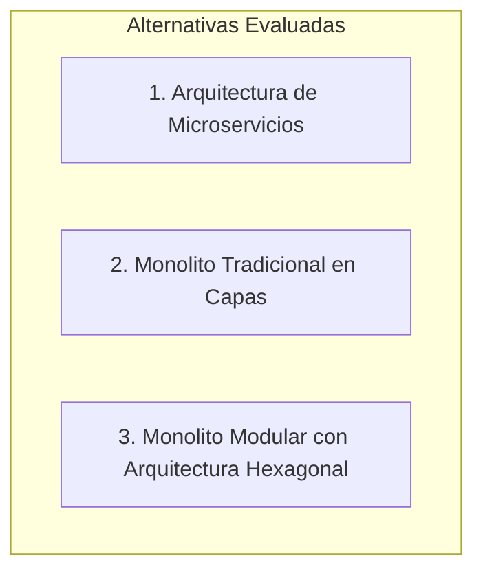
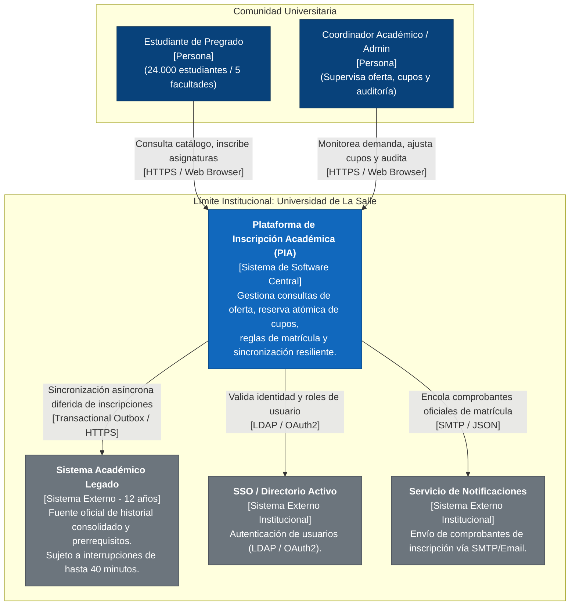
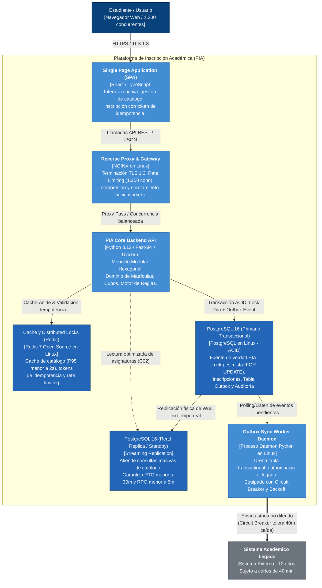
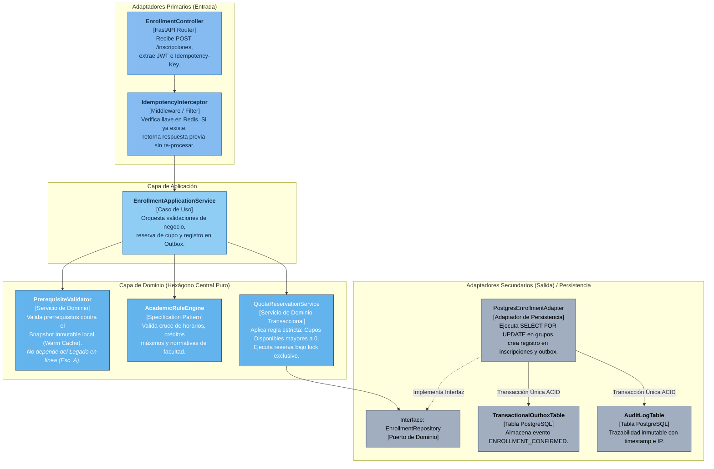
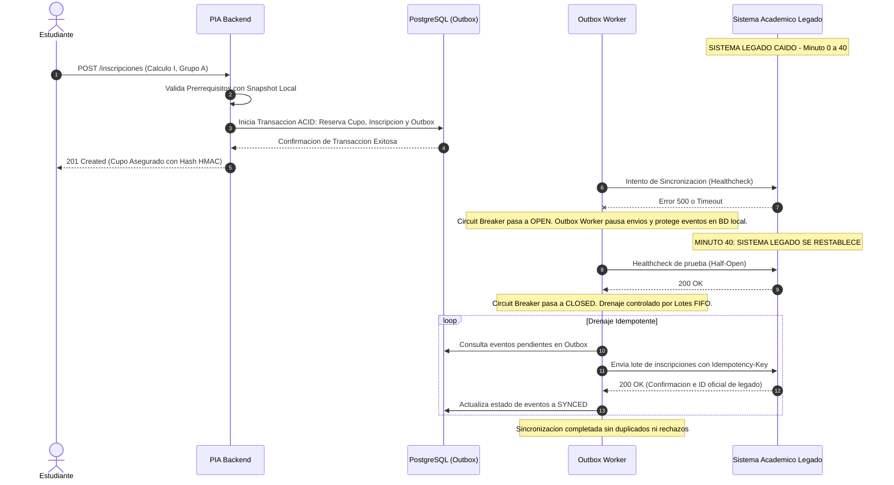

# Actividad 2: Diseño de la Estructura Arquitectónica

**Plataforma de Inscripción Académica (PIA) - Universidad de La Salle**  
- **Estudiante:** Andrés Luengas Sánchez  
- **Documento de Identidad:** Cédula de Ciudadanía (Terminación en 8)  
- **Correo Institucional:** aluengas98@unisalle.edu.co  
- **Situación Extraordinaria Asignada:** **Escenario A: Indisponibilidad** (Caída del sistema académico legado durante 40 minutos al inicio de la matrícula).  

---

## 1. Selección y Justificación del Estilo Arquitectónico

### 1.1 Alternativas Evaluadas

Para la Plataforma de Inscripción Académica (PIA), se evaluaron rigurosamente tres estilos arquitectónicos frente a los drivers identificados en la Actividad 1 y las restricciones de la Universidad de La Salle:



| Criterio de Decisión | Microservicios | Monolito en Capas Tradicional | Monolito Modular Hexagonal (Seleccionado) |
| :--- | :--- | :--- | :--- |
| **Capacidad del Equipo (C10: 4 devs, 1 sysadmin)** | **Crítico:** Desborda al equipo. Requiere orquestadores (K8s), mallas de servicio (*service mesh*), observabilidad distribuida y gestión de múltiples pipelines. | **Aceptable:** Fácil de construir inicialmente, pero propenso a deuda técnica acelerada y acoplamiento descontrolado. | **Óptimo:** Un único repositorio y artefacto desplegable; límites de módulo estrictos; muy bajo costo de mantenimiento cognitivo y operativo. |
| **Infraestructura (C08: Linux + PostgreSQL sin costos comerciales)** | **Desfavorable:** Demanda clústeres de cómputo distribuidos, balanceadores internos y alto consumo de memoria RAM por múltiples runtimes. | **Favorable:** Se despliega en una única máquina virtual o par de servidores Linux estándar. | **Óptimo:** Máximo aprovechamiento de recursos de cómputo y memoria; se ejecuta limpiamente en instancias Linux con PostgreSQL local. |
| **Consistencia de Cupos (C04: Cero sobrecupos)** | **Muy Complejo:** Requiere transacciones distribuidas (Saga / 2PC), con ventanas de inconsistencia temporal que arriesgan sobrecupos en picos de 1.200 usuarios. | **Vulnerable:** Lógica de negocio mezclada con controladores y base de datos (*Active Record* anémico), propenso a *race conditions*. | **Óptimo:** Límites transaccionales ACID locales y nativos en PostgreSQL con aislamiento `READ COMMITTED` y bloqueos de fila `SELECT FOR UPDATE`. |
| **Tolerancia a Falla del Legado de 40 min (C05, Escenario A)** | **Variable:** Requiere colas distribuidas externas (Kafka) que añaden complejidad operativa al equipo. | **Malo:** Fuerte acoplamiento síncrono; la caída del legado bloquea los hilos de ejecución de la aplicación. | **Óptimo:** Desacoplamiento mediante **Puertos y Adaptadores**: el adaptador del legado conmuta a modo contingencia y persiste eventos en el **Transactional Outbox**. |
| **Latencia de Consulta (C02: 95% < 2 seg)** | **Riesgo:** Sobrecarga de red entre microservicios (*network hop tax*) que incrementa la latencia acumulada. | **Medio:** Posible contención en una base de datos central sin segregación de lecturas. | **Óptimo:** Llamadas directas en memoria entre módulos internos y lecturas aceleradas con caché Redis. |

### 1.2 Justificación de la Elección: Monolito Modular con Arquitectura Hexagonal

Se selecciona el estilo **Monolito Modular (*Modular Monolith*) estructurado internamente bajo Arquitectura Hexagonal (*Ports & Adapters*)**, complementado con un patrón de mensajería asíncrona desacoplada mediante **Transactional Outbox**.

**Razones Arquitectónicas Fundamentadas:**
1. **Alineación con la Ley de Conway y Restricción Humana (C10):** Con solo 4 desarrolladores y 1 administrador de infraestructura, dispersar el esfuerzo en microservicios generaría una "bancarrota operacional". El monolito modular permite mantener la disciplina de diseño de dominios aislados (*Bounded Contexts*) sin el costo de red ni de despliegue distribuido.
2. **Cumplimiento Estricto de Infraestructura (C08):** Se compila y empaqueta en contenedores ligeros desplegables directamente en Linux, utilizando PostgreSQL 16 como motor transaccional primario sin requerir infraestructura cloud de terceros.
3. **Aislamiento del Dominio y Resiliencia ante el Legado (Escenario A):** La arquitectura hexagonal garantiza que las reglas de negocio de inscripción y cupos residan en el *Core de Dominio*, completamente desacopladas de las tecnologías de persistencia y de las APIs del sistema legado. Mediante el patrón *Ports and Adapters*, si el sistema legado se interrumpe durante 40 minutos, el núcleo transaccional de la PIA continúa operando sin alterarse, registrando los eventos en el Outbox para su sincronización diferida.

---

## 2. Diagramas de Arquitectura (Modelo C4)

### 2.1 C4 Nivel 1: Diagrama de Contexto de Sistema

Este nivel ilustra los usuarios principales, los límites institucionales de la Universidad de La Salle y las integraciones con sistemas periféricos.

> **Diagrama Vectorial SVG:** [Ver Diagrama de Contexto Vectorial SVG](diagramas/c4-nivel1-contexto.svg)



---

### 2.2 C4 Nivel 2: Diagrama de Contenedores

Este diagrama detalla los contenedores lógicos que conforman la PIA, su infraestructura subyacente en Linux y PostgreSQL (C08), y la separación de responsabilidades.

> **Diagrama Vectorial SVG:** [Ver Diagrama de Contenedores Vectorial SVG](diagramas/c4-nivel2-contenedores.svg)



---

### 2.3 C4 Nivel 3: Descomposición de Componentes del Módulo de Inscripciones y Cupos

Muestra la estructura interna hexagonal del módulo crítico donde se garantiza el cumplimiento de C04 (cero sobrecupos), C05 (aislamiento del legado) e idempotencia ante reintentos.

> **Diagrama Vectorial SVG:** [Ver Diagrama de Componentes Vectorial SVG](diagramas/c4-nivel3-componentes.svg)



---

## 3. Responsabilidades, Dependencias y Límites Transaccionales

### 3.1 Responsabilidades de Componentes Principales

| Componente | Responsabilidad Única | Dependencias Técnicas |
| :--- | :--- | :--- |
| **`EnrollmentController`** | Recibir la petición HTTP, validar formato de esquemas Pydantic y extraer cabeceras (`Idempotency-Key`, `Authorization`). | FastAPI, Pydantic. |
| **`IdempotencyInterceptor`** | Evitar procesar solicitudes duplicadas derivadas de reintentos del usuario (hasta 5 veces). Almacena el estado de la operación (`PENDING`, `COMPLETED`) y su respuesta en Redis con TTL de 24 horas. | Redis Client. |
| **`PrerequisiteValidator`** | Evaluar si el estudiante cumple los prerrequisitos académicos exigidos para el grupo solicitado, consultando el **Snapshot Académico Local** previamente cargado. No ejecuta peticiones de red hacia el legado durante la matrícula. | Repositorio de Snapshot Local. |
| **`AcademicRuleEngine`** | Implementar las reglas académicas (cruces de horario, créditos máximos permitidos por promedio, bloqueos administrativos). Diseñado bajo el patrón *Specification* para permitir agregar reglas en menos de 8 horas de desarrollo (QA-04). | Entidades del Dominio. |
| **`QuotaReservationService`** | Garantizar que ningún grupo supere su capacidad máxima autorizada (C04). Gestiona la disminución del cupo disponible bajo control de concurrencia atómico. | `EnrollmentRepository`. |
| **`PostgresEnrollmentAdapter`** | Traducir las entidades de dominio en sentencias SQL atómicas y ejecutarlas en PostgreSQL. | Motor PostgreSQL / `asyncpg`. |
| **`OutboxSyncWorker`** | Proceso demonio en segundo plano que lee eventos no sincronizados de la tabla `transactional_outbox`, gestiona el **Circuit Breaker** y sincroniza con el API del Sistema Legado de forma asíncrona y segura. | PostgreSQL, HTTP Client con reintentos y Jitter. |

---

### 3.2 Límites Transaccionales (Transactional Boundaries)

Para garantizar consistencia absoluta sin degradar el rendimiento, se delimitan dos fronteras transaccionales claramente diferenciadas:

```text
[ Transacción Local T1 (Síncrona - ACID) ]  ---> [ Transacción Remota T2 (Asíncrona - Eventual) ]
- Duración: < 25 ms                             - Duración: Segundos a Minutos (Diferida)
- Alcance: PostgreSQL Local (PIA)                - Alcance: Outbox Worker -> Sistema Académico Legado
- Operaciones Atómicas:                          - Tolerancia: Soporta hasta 40 min de caída sin fallo
  1. SELECT cupo FROM grupos FOR UPDATE;
  2. UPDATE grupos SET cupo = cupo - 1;
  3. INSERT INTO inscripciones (...);
  4. INSERT INTO transactional_outbox (...);
  5. INSERT INTO auditoria_trazabilidad (...);
  6. COMMIT;
```

1. **Límite Transaccional Local (T1 - Atómico y Síncrono):**
   - Abarca estrictamente la base de datos PostgreSQL de la PIA.
   - En una **única transacción ACID**, se verifica y reserva el cupo mediante bloqueo exclusivo a nivel de fila (`FOR UPDATE`), se registra la inscripción, se guarda el evento de integración en `transactional_outbox` y se genera el registro de auditoría.
   - **Tiempo de bloqueo:** La transacción se mantiene abierta únicamente durante las operaciones de escritura (menos de 20 ms), liberando el cerrojo de fila inmediatamente.

2. **Límite Transaccional Remoto (T2 - Diferido y Asíncrono):**
   - El envío hacia el Sistema Legado **NUNCA** forma parte de la transacción T1.
   - Se desacopla completamente a través de la tabla Outbox.
   - Si el sistema legado tarda en responder o se encuentra caído (Escenario A), la transacción T1 ya está confirmada y asegurada para el estudiante. No existe riesgo de transacciones colgadas ni de fallas en cascada.

---

### 3.3 Mecanismos de Comunicación

1. **Cliente Web a PIA Backend:** Comunicación síncrona vía **RESTful APIs sobre HTTPS (TLS 1.3)** con payloads en formato JSON.
2. **Capa Backend a Caché Redis:** Protocolo binario **RESP (REdis Serialization Protocol)** sobre sockets locales de alta velocidad para lecturas de catálogo y validación de idempotencia (< 2 ms de latencia).
3. **Capa Backend a PostgreSQL:** Pool de conexiones asíncronas persistentes gestionadas con **`asyncpg` / PgBouncer**, permitiendo reutilizar conexiones y atender 1.200 peticiones concurrentes sin saturar el sistema operativo.
4. **Outbox Worker a Sistema Legado:** Mensajería asíncrona mediante **REST/SOAP sobre HTTPS** con políticas de reintento exponencial (*Exponential Backoff* con *Full Jitter*) y control de salud mediante **Circuit Breaker**.

---

## 4. Tratamiento Exhaustivo del Escenario A (Indisponibilidad del Sistema Legado por 40 Minutos)

El último dígito del documento del estudiante es **8 (PAR)**, lo que activa el **Escenario A: Indisponibilidad del Sistema Académico Legado durante 40 minutos al inicio de la jornada de matrícula**.

A continuación se detalla cómo la arquitectura propuesta resuelve cada dimensión de esta contingencia extraordinaria:

### 4.1 ¿Qué Operaciones Pueden Continuar de Manera Autónoma?

| Operación | Viabilidad en Contingencia | Mecanismo Técnico que lo Hace Posible |
| :--- | :--- | :--- |
| **Autenticación e Inicio de Sesión** | **100% Operativa** | Se realiza contra el Directorio Activo institucional (SSO / LDAP), el cual es independiente del sistema académico legado. |
| **Consulta de Catálogo y Oferta de Grupos** | **100% Operativa** | Las asignaturas, horarios y docentes para el período se leen desde la réplica de PostgreSQL y la caché Redis de la PIA, sin tocar el legado. |
| **Verificación de Prerrequisitos Académicos** | **100% Operativa** | Se evalúa contra el **Snapshot Académico Pre-cargado (*Warm Cache*)** sincronizado la noche previa al inicio de matrículas. Puesto que las notas de períodos anteriores ya fueron cerradas oficialmente, este historial es estático y 100% confiable. |
| **Inscripción y Reserva Atómica de Cupos** | **100% Operativa** | La PIA es la autoridad transaccional del proceso de inscripción en curso. El cupo se bloquea y se descuenta atómicamente en PostgreSQL local; la inscripción queda confirmada localmente y el evento se almacena en el Outbox. |
| **Cancelación de Asignaturas del Período** | **100% Operativa** | El cupo se reintegra al grupo en PostgreSQL local y se encola un evento `ENROLLMENT_CANCELLED` en el Outbox. |

### 4.2 ¿Qué Operaciones Deben Restringirse Temporalmente?

Durante los 40 minutos de indisponibilidad se restringen únicamente operaciones que dependan de modificaciones activas en tiempo real dentro del legado:
1. **Solicitud de Grados o Paz y Salvos Financieros:** No hacen parte del proceso de matrícula regular.
2. **Consultas de Notas de Años Anteriores no Pre-cargadas en el Snapshot:** Se muestra un aviso de que el historial histórico completo estará disponible tras la ventana de mantenimiento del servidor central.
3. **Modificación de Mallas Curriculares o Creación de Nuevas Asignaturas en Vivo:** Se bloquean cambios estructurales en la oferta durante la ventana de matrícula.

---

### 4.3 ¿Cómo se Informa al Estudiante? (Experiencia de Usuario sin Pánico)

Para evitar que los estudiantes crean que el sistema falló y comiencen a reintentar masivamente solicitudes (lo cual saturaría el servidor):
1. **Banner Informativo de No Afectación:**
   En la interfaz de la SPA aparece un banner con fondo azul informativo:
   > *"Aviso Institucional: El enlace con el servidor de archivo central se encuentra en mantenimiento temporal programado. Tu inscripción en la PIA y la asignación de tu cupo quedan **100% garantizadas y confirmadas localmente**. La actualización en tu sábana de notas central se completará automáticamente en diferido."*
2. **Comprobante de Inscripción Digital con Firma Local:**
   Al confirmar la materia, el estudiante recibe un código de confirmación criptográfico (UUID v4 + hash HMAC) y un comprobante en pantalla con estado **"Inscripción Confirmada / Sincronización en Proceso"**, eliminando cualquier duda sobre la validez de su cupo.

---

### 4.4 ¿Cómo se Recupera la Operación Normal Evitando Inscripciones Inválidas?



1. **Estado del Circuit Breaker durante la Caída:** El Circuit Breaker pasa a estado `OPEN` tras 3 fallos consecutivos, suspendiendo las llamadas HTTP hacia el legado para no agotar hilos ni conexiones del servidor.
2. **Detección del Restablecimiento:** El worker ejecuta una prueba de latido (*heartbeat*) cada 30 segundos. Al minuto 40, al detectar 3 respuestas exitosas consecutivas, el circuito transiciona a `HALF-OPEN` y luego a `CLOSED`.
3. **Drenaje Idempotente por Lotes (*Batching FIFO*):**
   - El Outbox Worker lee los registros en estado `PENDING` ordenados cronológicamente por `created_at`.
   - Se envían en lotes de 100 registros mediante peticiones idempotentes que incluyen la cabecera `X-Transaction-Id`.
   - Si el legado llegase a recibir una solicitud repetida debido a una retransmisión de red, detecta el `X-Transaction-Id` y confirma el registro sin duplicar la matrícula.
4. **Garantía de Validez Académica:** Ninguna inscripción puede resultar inválida al llegar al legado porque todas las reglas y prerrequisitos fueron validados previamente con la misma lógica y catálogo oficial del snapshot. No se genera ninguna inscripción en conflicto.
