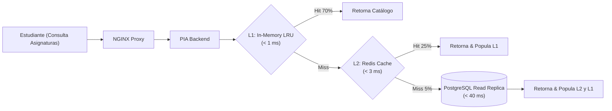
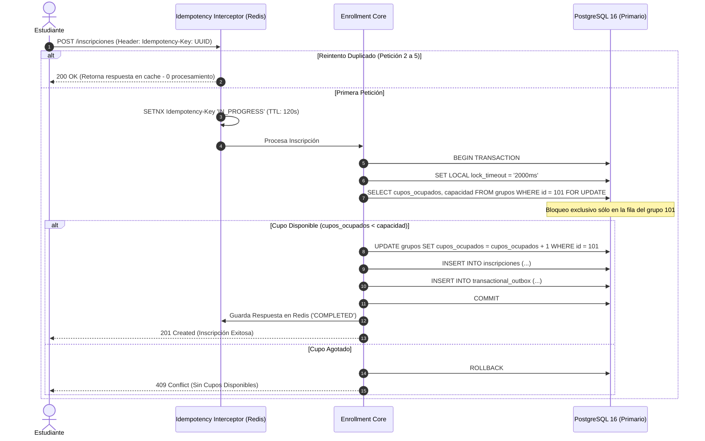
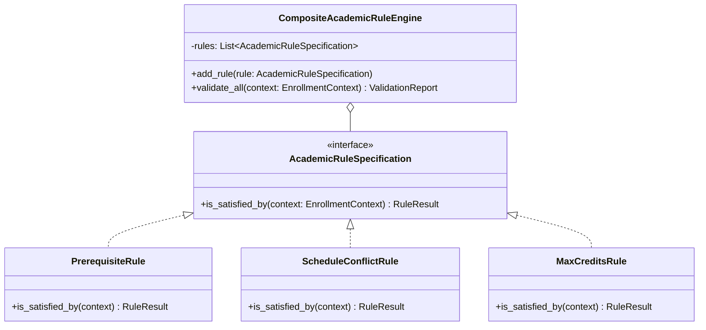

# Actividad 4: Selección y Validación de Tácticas Arquitectónicas

**Plataforma de Inscripción Académica (PIA) - Universidad de La Salle**  
- **Estudiante:** Andrés Luengas Sánchez  
- **Documento de Identidad:** Cédula de Ciudadanía (Terminación en 8)  
- **Correo Institucional:** aluengas98@unisalle.edu.co  
- **Situación Extraordinaria Asignada:** **Escenario A: Indisponibilidad** (Caída del sistema académico legado durante 40 minutos al inicio de la matrícula).  

---

## 1. Introducción y Enfoque de Diseño

Una arquitectura de software no alcanza sus atributos de calidad por accidente ni por simple elección de tecnologías, sino mediante la aplicación deliberada de **Tácticas Arquitectónicas** (técnicas de diseño que controlan y mejoran directamente las respuestas ante estímulos específicos de calidad, según el marco SEI).

Para la Plataforma de Inscripción Académica (PIA) de la Universidad de La Salle, se seleccionaron cuatro tácticas prioritarias orientadas a mitigar los dolores históricos y satisfacer las condiciones de operación (C01 a C10), resolviendo de manera concluyente el **Escenario A (Indisponibilidad del Sistema Legado por 40 minutos)**.

---

## 2. Táctica 1: Aislamiento de Fallas y Degradación Agraciada (*Circuit Breaker* + *Snapshot Caching* + *Transactional Outbox*)

```mermaid
stateDiagram-v2
    [*] --> CLOSED: Operación Normal
    CLOSED --> OPEN: 3 Fallos Consecutivos o Timeout (Legado Caído 40 min)
    note right of OPEN: Modo Contingencia (Escenario A):<br/>- Valida Prerrequisitos con Snapshot Local<br/>- Reserva Cupos en PostgreSQL Local<br/>- Encola en Transactional Outbox<br/>- Muestra Banner Informativo
    OPEN --> HALF_OPEN: Transcurridos 30s de Cooldown (Probe Heartbeat)
    HALF_OPEN --> CLOSED: 3 Peticiones de Prueba Exitosas (Legado Restablecido)
    HALF_OPEN --> OPEN: Si Falla Petición de Prueba
```

### 2.1 Atributo de Calidad que Busca Mejorar
**Disponibilidad y Resiliencia (QA-01 / DRV-02, DRV-04):** Garantizar disponibilidad mensual $\ge 99,9\%$ (C03) y soportar la indisponibilidad total de hasta 40 minutos del sistema legado (C05, Escenario A) sin interrumpir el proceso de matrícula ni generar errores 5xx al usuario final.

### 2.2 Problema Específico que Pretende Resolver
El sistema legado de más de 12 años suele caerse al inicio de la matrícula. En una integración convencional, cuando el legado se interrumpe, las peticiones entrantes de los 1.200 estudiantes se quedan esperando respuestas en conexiones de red abiertas hasta alcanzar el *timeout*. Esto causa un agotamiento total del pool de conexiones y de los hilos del servidor de la PIA (*Thread Pool Starvation*), derribando toda la plataforma en cascada y perdiendo las solicitudes de los estudiantes.

### 2.3 Componentes en los Cuales se Implementa
- `LegacyIntegrationAdapter` (Adaptador de salida hacia el sistema legado).
- `CircuitBreakerManager` (Controlador de estados y métricas de salud).
- `PrerequisiteSnapshotStore` (Repositorio local de prerrequisitos en PostgreSQL y Redis).
- `TransactionalOutboxService` y `OutboxSyncWorker` (Persistencia y drenaje asíncrono de eventos).

### 2.4 Funcionamiento Técnico Detallado
1. **Pre-cálculo de Prerrequisitos (Warm Cache):** La noche previa a la matrícula, la PIA sincroniza un snapshot inmutable de los antecedentes académicos de los 24.000 estudiantes.
2. **Detección Inmediata del Fallo (Escenario A):** Cuando el sistema legado deja de responder, el Circuit Breaker registra el fallo. Tras 3 errores consecutivos de red o tiempos de espera que superen el timeout configurado (2.000 ms), el circuito transiciona inmediatamente a estado **`OPEN`**.
3. **Degradación Agraciada (*Graceful Fallback*):** En estado `OPEN`, el sistema intercepta las llamadas hacia el legado y activa la ruta de contingencia local:
   - Valida prerrequisitos en microsegundos contra el snapshot local inmutable.
   - Ejecuta la reserva del cupo en PostgreSQL local.
   - Registra el evento de matrícula en la tabla `transactional_outbox` con estado `PENDING`.
   - Retorna una confirmación exitosa al estudiante con el aviso informativo de sincronización en diferido.
4. **Recuperación Automática:** Cada 30 segundos, el Circuit Breaker permite una petición de prueba hacia el legado (estado `HALF-OPEN`). Al minuto 40, cuando el legado responde exitosamente 3 veces consecutivas, el circuito vuelve a `CLOSED` y el `OutboxSyncWorker` inicia el drenaje en lotes controlados (*Batch FIFO*) sin sobrecargar al sistema legado.

### 2.5 Beneficios y Costos Asociados
- **Beneficios:** Disponibilidad del 100% percibida por el estudiante durante la caída de 40 minutos; cero transacciones colgadas; cero degradación de hilos del servidor Linux; cero pérdida de matrículas.
- **Costos:** Almacenamiento local adicional de ~45 MB para el snapshot de prerrequisitos de los 24.000 estudiantes en PostgreSQL; retraso temporal de hasta 40 minutos en la visibilidad del registro oficial dentro del sistema legado viejo.

### 2.6 Mecanismo para Verificar su Efectividad
- **Herramienta:** Simulación de fallos con **Toxiproxy** o script de corte forzado de socket TCP hacia el mock del sistema legado.
- **Prueba:**
  1. Iniciar una ráfaga continua de 200 peticiones de inscripción por minuto.
  2. Al minuto 1, activar Toxiproxy para cortar el 100% del tráfico hacia el legado simulando la falla de 40 minutos del Escenario A.
  3. Verificar que el Circuit Breaker transicione a `OPEN` en menos de 6 segundos.
  4. Constatar que el 100% de las inscripciones válidas continúen respondiendo HTTP 201 Created y que los eventos se acumulen en `transactional_outbox`.
  5. Restaurar la conectividad al minuto 40 y verificar que el Outbox Worker drene todos los eventos acumulados sin errores ni duplicados.
- **Métricas Clave:** `circuit_breaker_state == OPEN`, tasa de errores HTTP 5xx $= 0\%$, eventos outbox encolados $= 100\%$, eventos fallidos $= 0$.

---

## 3. Táctica 2: Caché Multinivel (*Cache-Aside L1/L2*) con Réplicas de Lectura



### 3.1 Atributo de Calidad que Busca Mejorar
**Rendimiento y Latencia (QA-02 / DRV-03):** Cumplimiento estricto de la Condición C02 (el 95% de las consultas de asignaturas y grupos debe responder en máximo 2,0 segundos) bajo la concurrencia de 1.200 estudiantes simultáneos (C01).

### 3.2 Problema Específico que Pretende Resolver
Durante los períodos de matrícula, la inmensa mayoría de las solicitudes de los 1.200 usuarios son consultas de lectura repetitivas (explorar qué materias están abiertas, verificar horarios, ver cupos disponibles). Si cada consulta golpea directamente el disco de la base de datos transaccional primaria, el subsistema de I/O de PostgreSQL se satura en segundos, disparando los tiempos de respuesta por encima de los 15 segundos y colapsando el servidor.

### 3.3 Componentes en los Cuales se Implementa
- `CatalogQueryService` (Servicio de lectura de asignaturas).
- L1 In-Memory LRU Cache (Caché local en el proceso de Python/FastAPI con `cachetools`).
- L2 Distributed Cache (Servidor Redis 7 en Linux).
- Read-Replica de PostgreSQL 16 (Streaming replication física).

### 3.4 Funcionamiento Técnico Detallado
1. **Patrón Cache-Aside Multinivel:**
   - **Nivel L1 (In-Process):** Cada worker de Uvicorn mantiene un caché LRU en RAM con las 500 asignaturas más demandadas con un TTL de 15 segundos. Latencia: $< 0.5\text{ ms}$.
   - **Nivel L2 (Redis Centralizado):** Si la consulta no está en L1, se consulta Redis donde reside el catálogo completo pre-serializado en JSON binario con un TTL de 60 segundos. Latencia: $< 3\text{ ms}$.
   - **Nivel L3 (Read Replica):** Si ocurre un cache miss en L2, la lectura se desvía a la **Réplica de Lectura de PostgreSQL**, protegiendo al nodo primario de escrituras de cualquier carga de lectura.
2. **Invalidación Inteligente por Eventos:** Cuando un grupo agota su cupo en el nodo primario de PostgreSQL, se emite un mensaje local de invalidación hacia Redis (`PUBLISH catalog_invalidate {grupo_id}`), asegurando que los estudiantes vean la disponibilidad actualizada sin esperar la expiración pasiva del TTL.

### 3.5 Beneficios y Costos Asociados
- **Beneficios:** Latencia de consulta reducida a un percentil $P_{95} \le 45\text{ ms}$ (más de 40 veces más veloz que los 2.000 ms requeridos por C02); absorción de más del 95% del tráfico antes de llegar a la base de datos primaria.
- **Costos:** Consumo de memoria RAM (~1 GB en Redis para catálogos y horarios); ligera complejidad para gestionar la invalidación de caché ante modificaciones de última hora en la oferta docente.

### 3.6 Mecanismo para Verificar su Efectividad
- **Herramienta:** Pruebas de estrés y rendimiento con **k6**.
- **Prueba:**
  - Script k6 simulando 1.200 usuarios virtuales (*Virtual Users - VUs*) navegando el catálogo de asignaturas, consultando grupos y horarios con un patrón de llegada de 300 peticiones por segundo durante 10 minutos.
- **Métricas Clave:**
  - $P_{95} \le 120\text{ ms}$ (muy por debajo del límite de $2.000\text{ ms}$ de C02).
  - Tasa de acierto de caché (*Cache Hit Ratio*) $\ge 94\%$.
  - Uso de CPU en el nodo primario de PostgreSQL $< 25\%$.

---

## 4. Táctica 3: Bloqueo Pesimista Atómico a Nivel de Fila (`SELECT FOR UPDATE`) respaldado por Clave de Idempotencia



### 4.1 Atributo de Calidad que Busca Mejorar
**Consistencia Transaccional e Integridad (QA-03 / DRV-01):** Cumplimiento absoluto de la Condición C04 (*"Ningún grupo académico puede registrar más estudiantes que su capacidad autorizada"*) y neutralización de inscripciones duplicadas provocadas por reintentos de usuarios (hasta 5 reintentos por estudiante).

### 4.2 Problema Específico que Pretende Resolver
Bajo alta concurrencia, si dos o más transacciones leen al mismo tiempo que queda 1 cupo disponible, ambas proceden a inscribir al estudiante, provocando sobrecupos no autorizados. Además, cuando un estudiante presiona repetidamente el botón de confirmación debido a retrasos en la red, se envían múltiples solicitudes que pueden registrar al mismo estudiante dos veces o reservar cupos duplicados para una misma asignatura.

### 4.3 Componentes en los Cuales se Implementa
- `IdempotencyMiddleware` (Filtro HTTP de entrada).
- `QuotaReservationService` (Servicio de Dominio).
- `PostgresEnrollmentAdapter` (Adaptador de persistencia ACID).
- Motor de Base de Datos PostgreSQL 16.

### 4.4 Funcionamiento Técnico Detallado
1. **Control de Idempotencia en Capa Web:** Cada llamada de inscripción requiere una cabecera HTTP `Idempotency-Key` (UUIDv4 generado por el cliente al presionar el botón). El middleware registra esta llave en Redis con el comando atómico `SET key IN_PROGRESS NX EX 120`. Si el usuario envía 5 solicitudes idénticas, las 4 siguientes detectan la llave existente y esperan el resultado de la primera o reciben la confirmación previa cacheada, bloqueando de raíz la duplicación.
2. **Bloqueo Pesimista en PostgreSQL:** La primera petición inicia una transacción local con timeout defensivo:
   ```sql
   BEGIN;
   SET LOCAL lock_timeout = '2000ms';
   SELECT id, cupos_ocupados, capacidad 
   FROM grupos 
   WHERE id = :grupo_id 
   FOR UPDATE;
   ```
   La cláusula `FOR UPDATE` coloca un cerrojo exclusivo a nivel de fila únicamente en el grupo solicitado. Cualquier otra transacción sobre ese mismo grupo debe esperar a que la primera haga `COMMIT` o `ROLLBACK`.
3. **Validación y Mutación Atómica:** La base de datos evalúa estrictamente `cupos_ocupados < capacidad`. Si es verdadero, incrementa el contador e inserta la inscripción y el evento Outbox. La transacción dura menos de 20 ms en promedio, liberando el cerrojo de fila inmediatamente.

### 4.5 Beneficios y Costos Asociados
- **Beneficios:** Garantía matemática del 100% de que ningún grupo superará su capacidad autorizada (0 sobrecupos); erradicación total de registros duplicados por reintentos de usuario.
- **Costos:** Pequeña contención secuencial cuando decenas de usuarios compiten por la última vacante en el mismo milisegundo; necesidad de almacenar llaves de idempotencia en Redis durante 24 horas.

### 4.6 Mecanismo para Verificar su Efectividad
- **Herramienta:** Script de prueba de concurrencia extrema en Python con `asyncio` y `httpx`.
- **Prueba:**
  1. Configurar un grupo de prueba con exactamente **1 cupo disponible** (`capacidad = 30, cupos_ocupados = 29`).
  2. Lanzar concurrentemente **100 solicitudes de inscripción simultáneas** desde 100 estudiantes distintos en una ventana de 1 segundo.
  3. Adicionalmente, configurar cada cliente para que envíe **5 reintentos automáticos** con la misma `Idempotency-Key`.
- **Métricas Clave:**
  - Número de inscripciones confirmadas (HTTP 201) $= 1$.
  - Número de rechazos por falta de cupo (HTTP 409) $= 99$.
  - Solicitudes duplicadas frenadas por idempotencia $= 400$.
  - Capacidad final registrada en la base de datos $= 30 / 30$ (Sobrecupos $= 0$).

---

## 5. Táctica 4: Especificación y Motor de Reglas Desacoplado (*Specification Pattern*)



### 5.1 Atributo de Calidad que Busca Mejorar
**Modificabilidad y Mantenibilidad (QA-04 / DRV-07):** Reducir drásticamente el esfuerzo técnico para incorporar, ajustar o parametrizar nuevas reglas académicas por parte del equipo institucional de **4 desarrolladores (C10)**, resolviendo uno de los dolores más críticos del sistema legado anterior.

### 5.2 Problema Específico que Pretende Resolver
En el sistema anterior de 12 años, las reglas académicas (e.g., límites de créditos, excepciones de promedio ponderado, requisitos de inglés, validaciones por facultad) se encontraban dispersas e incrustadas en procedimientos almacenados (*stored procedures*) de miles de líneas y código espagueti. Cada cambio normativo aprobado por el Consejo Académico requería semanas de esfuerzo técnico, pruebas manuales riesgosas y generaba efectos secundarios inesperados.

### 5.3 Componentes en los Cuales se Implementa
- `AcademicRuleEngine` (Núcleo del Dominio).
- Interfaz `AcademicRuleSpecification` y clases concretas (`ScheduleConflictRule`, `MaxCreditsRule`, `PrerequisiteRule`, `FacultyCrossRegistrationRule`).
- `RuleCatalogRegistry` (Contenedor de inyección de dependencias).

### 5.4 Funcionamiento Técnico Detallado
1. **Patrón Specification:** Cada regla académica se encapsula en una clase independiente que implementa un contrato estándar:
   ```python
   class AcademicRuleSpecification(Protocol):
       def is_satisfied_by(self, context: EnrollmentContext) -> RuleResult:
           ...
   ```
2. **Encadenamiento Jerárquico:** El motor `AcademicRuleEngine` evalúa una colección de especificaciones en memoria utilizando cortocircuito lógico (*short-circuit evaluation*). Si una regla falla (e.g. cruce de horario), el motor detiene la evaluación inmediatamente y retorna un mensaje de error legible y accionable para el estudiante.
3. **Incorporación sin Efectos Secundarios:** Cuando la universidad aprueba una nueva directiva (e.g., "Estudiantes con promedio superior a 4.5 pueden matricular hasta 22 créditos"), el desarrollador únicamente crea un nuevo archivo de regla y lo registra en el contenedor. **Cero líneas de código existentes se modifican**, respetando estrictamente el principio *Open/Closed* de SOLID.

### 5.5 Beneficios y Costos Asociados
- **Beneficios:** Tiempo de desarrollo para una nueva regla reducido de semanas a **menos de 4 horas-hombre**; cobertura de pruebas unitarias al 100% mediante mocks en memoria; cero riesgo de regresiones en reglas preexistentes.
- **Costos:** Mayor número de clases individuales en el código base; necesidad de que los 4 desarrolladores conozcan y respeten el patrón de diseño.

### 5.6 Mecanismo para Verificar su Efectividad
- **Herramienta:** Suite de pruebas unitarias automatizadas con `pytest`.
- **Prueba:**
  1. Diseñar una nueva regla académica no prevista: *"Un estudiante no puede inscribir más de 2 asignaturas virtuales simultáneamente"*.
  2. Implementar la regla como una nueva clase `MaxVirtualCoursesRule` y asociarla al motor.
  3. Ejecutar la suite completa de pruebas unitarias.
- **Métricas Clave:**
  - Tiempo de implementación y testing $< 4\text{ horas-hombre}$.
  - Cobertura de pruebas unitarias del módulo de reglas $\ge 95\%$.
  - Tasa de regresión en pruebas existentes $= 0\%$.

---

## 6. Cuadro Resumen de Tácticas y su Impacto en los Drivers

| Táctica Arquitectónica | Atributo de Calidad | Driver Impactado | Componente Principal | Métrica de Aceptación Cuantificable |
| :--- | :--- | :--- | :--- | :--- |
| **Circuit Breaker + Snapshot + Outbox** | Disponibilidad & Resiliencia | DRV-02 (Esc. A), DRV-04, C03, C05 | `CircuitBreaker`, `OutboxWorker` | $0\%$ caídas en corte de 40 min; $100\%$ eventos sincronizados en diferido. |
| **Caché Multinivel L1/L2 + Read Replicas** | Rendimiento & Escalabilidad | DRV-03, C01, C02 | NGINX, Redis, PostgreSQL Replica | $P_{95} \le 150\text{ ms} \ll 2.0\text{ s}$ con 1.200 usuarios concurrentes. |
| **Bloqueo Pesimista Fila + Idempotencia** | Consistencia Transaccional | DRV-01, C04, C07 | PostgreSQL (`FOR UPDATE`), Redis | $0$ sobrecupos autorizados; $0$ registros duplicados ante 5 reintentos. |
| **Specification Pattern para Reglas** | Modificabilidad & Mantenibilidad | DRV-07, C10, Dolor Legado | `AcademicRuleEngine` | Nueva regla creada y testeada en $\le 4$ horas por 1 desarrollador. |
