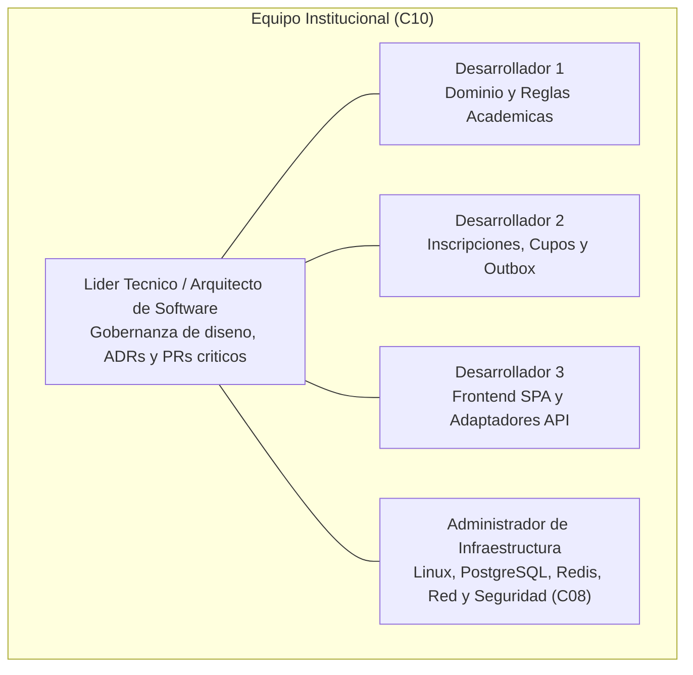
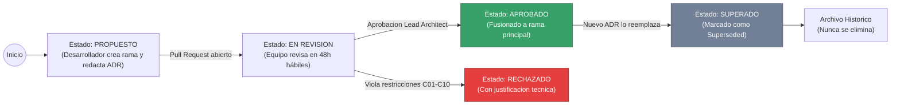
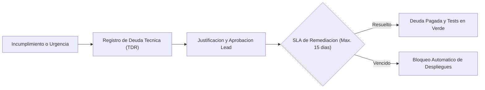

# Actividad 5: Gobernanza de Arquitectura

**Plataforma de Inscripción Académica (PIA) - Universidad de La Salle**  
- **Estudiante:** Andrés Luengas Sánchez  
- **Documento de Identidad:** Cédula de Ciudadanía (Terminación en 8)  
- **Correo Institucional:** aluengas98@unisalle.edu.co  
- **Situación Extraordinaria Asignada:** **Escenario A: Indisponibilidad** (Caída del sistema académico legado durante 40 minutos al inicio de la matrícula).  

---

## 1. Modelo de Gobernanza Adaptado al Equipo Institucional

Un error frecuente en proyectos de software es trasladar comités corporativos pesados de arquitectura a equipos compactos, lo que deriva en burocracia inoperante o abandono total de las buenas prácticas. 

Para la Universidad de La Salle, la gobernanza se diseña a la medida de la restricción **C10: un equipo de 4 desarrolladores y 1 administrador de infraestructura**, balanceando agilidad de entrega con control estricto de la calidad técnica:



### 1.1 Matriz de Responsabilidades (RACI)

| Actividad / Decisión | Arquitecto / Lead | Desarrolladores (3) | Administrador Infraestructura |
| :--- | :---: | :---: | :---: |
| Modificación o Creación de un ADR | **Accountable (A)** | Responsible (R) | Consulted (C) |
| Alteración del Esquema de Base de Datos PostgreSQL | Accountable (A) | Responsible (R) | Responsible / Consulted (R/C) |
| Ajuste de Reglas en Motor Académico (*Specification*) | Informed (I) | Responsible (R) | Informed (I) |
| Configuración de NGINX, Redis o Parámetros Linux | Consulted (C) | Informed (I) | Accountable / Responsible (A/R) |
| Aprobación de Pull Request a rama `main` / `dev` | **Accountable (A)** | Responsible (R) | Consulted (C) |
| Declaración y Remediación de Deuda Técnica | Accountable (A) | Responsible (R) | Informed (I) |

*Leyenda: **R**esponsable (quien ejecuta), **A**ccountable (quien rinde cuentas y aprueba), **C**onsultado, **I**nformado.*

---

## 2. Tres Políticas o Reglas Arquitectónicas Verificables

Para evitar que la arquitectura se degrade con el tiempo, se establecen tres reglas inmutables de cumplimiento obligatorio, verificadas automáticamente por software:

### Regla 1: Aislamiento Hexagonal Estricto del Dominio (Pureza de Dependencias)
- **Enunciado de la Política:** El núcleo de dominio (`app/domain`) debe mantenerse 100% puro y agnóstico a cualquier tecnología de persistencia, interfaz gráfica o framework externo. Está estrictamente prohibido importar módulos de `sqlalchemy`, `asyncpg`, `sqlmodel`, `fastapi`, `starlette` o clientes HTTP dentro de los archivos del dominio.
- **Razón Arquitectónica:** Asegura que las reglas de negocio de matrícula y cupos no se contaminen con detalles de infraestructura, garantizando testabilidad unitaria en milisegundos y facilidad de mantenimiento para el equipo (C10).
- **Mecanismo de Verificación:** Verificación estática automatizada en el pipeline de CI (`.github/workflows/arch-governance.yml`) mediante análisis AST que bloquea el build si se detecta una importación prohibida.

### Regla 2: Obligatoriedad de Idempotencia y Transaccionalidad en Comandos de Matrícula
- **Enunciado de la Política:** Todo endpoint HTTP que mute el estado de inscripción o cupos (POST/DELETE) debe exigir obligatoriamente la cabecera `Idempotency-Key` (UUIDv4) y ejecutar la reserva de cupo dentro de una transacción PostgreSQL con timeout defensivo explícito (`SET LOCAL lock_timeout = '2000ms'`) utilizando bloqueo a nivel de fila (`SELECT ... FOR UPDATE`).
- **Razón Arquitectónica:** Cumplimiento no negociable de la Condición C04 (cero sobrecupos) y neutralización de hasta 5 reintentos automáticos por estudiante impaciente.
- **Mecanismo de Verificación:** Pruebas unitarias y de integración automáticas que intentan ejecutar inscripciones concurrentes y reintentos sin token, comprobando el rechazo con código HTTP 400 Bad Request.

### Regla 3: Prohibición de Sincronización Síncrona Directa con el Sistema Legado
- **Enunciado de la Política:** Ningún controlador o servicio del flujo de matrícula tiene permitido realizar llamadas HTTP/SOAP directas y síncronas hacia el sistema legado en el camino crítico del usuario. Toda comunicación con el legado debe canalizarse exclusivamente a través de la tabla `transactional_outbox` en la base de datos PostgreSQL local.
- **Razón Arquitectónica:** Protege a la PIA contra el **Escenario A (caída de 40 minutos del sistema legado)**, evitando caídas en cascada y garantizando la disponibilidad mensual del 99,9% (C03).
- **Mecanismo de Verificación:** Linter de arquitectura en CI que escanea el código en busca de llamadas síncronas a clientes del legado dentro de los casos de uso principales.

---

## 3. Procedimiento para Proponer, Revisar, Aprobar y Actualizar un ADR

El Registro de Decisión Arquitectónica (ADR) es la herramienta fundamental para mantener la memoria técnica y evitar que decisiones críticas se tomen por capricho o moda:



### 3.1 Etapas del Procedimiento

1. **Propuesta (Draft):**
   - Cualquier desarrollador del equipo institucional puede proponer un cambio estructural o tecnológico.
   - Crea una rama `adr/ADR-XXX-nombre-corto` y redacta el documento en `docs/actividad3/` siguiendo la plantilla estandarizada: *Identificador, Título, Fecha, Estado, Contexto y Problema, Drivers Relacionados, Mínimo 2 Alternativas Viables, Criterios de Comparación, Decisión y Justificación, Consecuencias (Positivas, Negativas y Riesgos) y Condiciones de Revisión*.
2. **Revisión Técnica y Debate:**
   - Se abre un Pull Request etiquetado como `architecture-decision`.
   - El equipo dispone de un **plazo máximo de 48 horas hábiles** para revisar y comentar el documento.
   - Si la decisión afecta servidores, bases de datos o redes Linux, el Administrador de Infraestructura tiene voto consultivo obligatorio.
3. **Decisión y Aprobación:**
   - La aprobación requiere el visto bueno explícito del **Líder Técnico / Arquitecto**.
   - El estado cambia de `Proposed` a `Accepted` (o `Rejected` indicando la razón técnica).
4. **Actualización y Obsolescencia (*Superseded*):**
   - Un ADR aprobado **jamás se borra ni se modifica sustancialmente en su contenido histórico**.
   - Si las condiciones del negocio cambian (e.g., la universidad reemplaza el legado por un SIS moderno), se redacta un nuevo ADR (e.g., `ADR-007`) que marca explícitamente al ADR anterior como `Superseded by ADR-007`.

---

## 4. Mecanismos de Control Automático Integrados al Repositorio

La gobernanza se hace cumplir mediante automatización integrada en **GitHub Actions** (archivos reales configurados en el repositorio):

### 4.1 Mecanismo 1: Verificación Automática de Reglas Arquitectónicas
- **Archivo en Repositorio:** [`.github/workflows/arch-governance.yml`](../.github/workflows/arch-governance.yml)
- **Comportamiento en Cada Push / PR:**
  1. Analiza el código fuente con scripts de introspección AST y linters de arquitectura.
  2. **Valida la Regla 1:** Comprueba que en la carpeta `app/domain` no existan importaciones de librerías de persistencia (`sqlalchemy`, `asyncpg`) ni frameworks web (`fastapi`).
  3. **Valida la Regla 3:** Comprueba que no existan clientes HTTP del legado invocados directamente sin el patrón Outbox.
  4. **Valida la Integridad de ADRs:** Verifica que todos los archivos en `docs/actividad3/` contengan obligatoriamente las secciones estructurales requeridas. Si alguna falta, el pipeline falla de inmediato.

### 4.2 Mecanismo 2: Pipeline de Pruebas Automatizadas y Análisis de Seguridad
- **Archivo en Repositorio:** [`.github/workflows/test-pipeline.yml`](../.github/workflows/test-pipeline.yml)
- **Comportamiento en Cada Push / PR:**
  1. Ejecuta la suite de pruebas unitarias y de integración mediante `pytest`.
  2. Exige un **umbral mínimo de cobertura de código del 80% (`--cov-fail-under=80`)**. Si la cobertura disminuye, el PR queda bloqueado.
  3. Ejecuta análisis de vulnerabilidades de seguridad estática con `bandit` para verificar que no existan contraseñas quemadas en código, inyecciones SQL ni prácticas inseguras.

---

## 5. Procedimiento para Manejar Excepciones, Incumplimientos y Deuda Técnica

La deuda técnica no controlada es la causa principal del deterioro de los sistemas legados. Para evitar repetir el ciclo del sistema de hace 12 años, se establece el siguiente protocolo de contención:



1. **Protocolo de Excepción Temporal (Technical Debt Record - TDR):**
   - Si por una urgencia mayor de matrícula se requiere omitir temporalmente una regla arquitectónica (e.g. un parche rápido para un grupo con horario especial), el desarrollador debe crear un issue en Git etiquetado como `tech-debt` con el formato:
     - *Regla infringida y componente afectado.*
     - *Razón de negocio insalvable.*
     - *Riesgo asumido a corto plazo.*
     - *Fecha improrrogable de remediación (SLA máximo de 15 días o fin de período de matrícula).*
2. **SLA de Remediación Obligatorio:**
   - La deuda técnica debe resolverse dentro del siguiente sprint de trabajo.
   - Si un TDR supera los 15 días sin ser remediado, el pipeline de CI bloquea automáticamente la aprobación de cualquier nueva característica (*feature freeze*), obligando al equipo a pagar la deuda técnica antes de continuar.
3. **Límite de Deuda Acumulada:**
   - No pueden existir más de **2 TDRs activos simultáneamente** en el repositorio. Si se intenta abrir un tercero, debe ser rechazado de inmediato.

---

## 6. Estrategia de Documentación Viva (*Living Documentation & Architecture as Code*)

Para asegurar que la documentación y los diagramas evolucionen de forma idéntica al código fuente:
1. **Diagramas como Código (Mermaid y SVG Versionados):** Todos los diagramas C4 se almacenan en formato texto editable (`Mermaid` embebido en Markdown) y en formatos vectoriales SVG dentro de la carpeta `docs/diagramas/`. Están sujetos a control de versiones Git, code reviews y diffs visuales en cada Pull Request.
2. **Regla de Co-Commit Obligatoria:** Si un Pull Request introduce un cambio en una entidad del dominio, en un endpoint de API o en la interacción con el sistema legado, el Pull Request **debe incluir obligatoriamente la actualización del archivo Markdown correspondiente en `docs/`**. Un PR que cambie la arquitectura sin actualizar la documentación es rechazado automáticamente.
3. **Generación Continua de Especificaciones:** La especificación OpenAPI (Swagger JSON/YAML) se genera automáticamente a partir de los esquemas Pydantic del backend en tiempo de compilación, asegurando que la documentación de contratos API jamás esté desactualizada.

---

## 7. Criterios Explícitos de Aceptación o Rechazo de Pull Requests (PR Checklist)

Todo cambio de código en la PIA debe superar la siguiente lista de verificación estricta para ser aceptado e integrado a la rama `main` o de desarrollo (`dev_aluengas98`):

### 7.1 Criterios de Rechazo Inmediato (*Hard Rejections*)
Un Pull Request será **RECHAZADO INMEDIATAMENTE**, sin excepción, si presenta alguna de las siguientes condiciones:
- El pipeline de verificación arquitectónica (`arch-governance.yml`) falla con error rojo.
- La suite de pruebas automatizadas falla o la cobertura desciende por debajo del 80%.
- Se detecta una llamada síncrona directa hacia el sistema legado en el flujo de matrícula.
- Se intenta mutar cupos de un grupo sin utilizar bloqueo atómico pesimista (`FOR UPDATE`) o sin cabecera de idempotencia.
- Se introducen dependencias o librerías de software comercial licenciado (violación de C08).

---

### 7.2 Checklist Mandatorio de Aprobación (Definition of Done - DoD)

Antes de fusionar (*merge*), el revisor debe verificar cada casilla:

```markdown
### Lista de Chequeo de Calidad Arquitectónica (PR Checklist)

- [ ] **1. Conformidad de Dominio:** ¿El código de negocio reside exclusivamente en `app/domain` sin dependencias de frameworks ni ORMs?
- [ ] **2. Consistencia de Cupos (C04):** ¿La mutación de cupos está protegida por transacción ACID atómica, bloqueo pesimista y timeout acotado?
- [ ] **3. Protección contra Reintentos:** ¿El endpoint exige y valida la cabecera `Idempotency-Key`?
- [ ] **4. Resiliencia ante el Legado (C05 / Esc. A):** ¿Toda comunicación hacia el legado está desacoplada mediante la tabla `transactional_outbox` y protegida por Circuit Breaker?
- [ ] **5. Restricción Tecnológica (C08):** ¿El cambio se ejecuta 100% sobre Linux y PostgreSQL estándar sin librerías comerciales?
- [ ] **6. Pruebas Automatizadas:** ¿Se agregaron pruebas unitarias para las nuevas reglas y la cobertura global es >= 80%?
- [ ] **7. Documentación Viva:** ¿Se actualizaron los documentos en `docs/` y los diagramas C4 si hubo cambios de diseño?
- [ ] **8. Aprobación Humana:** ¿El PR cuenta con el Review formal y aprobación (LGTM) del Líder Técnico / Arquitecto?
```
